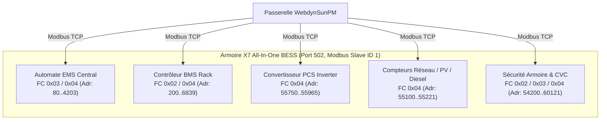

# Rapport Technique d'Ingénierie — Génération et Certification des Fichiers de Définition X7 C&I BESS (All-In-One)

**Date d'homologation** : 19 novembre 2026  
**Constructeur / Marque** : X7 / X7 Energy  
**Système** : X7 Commercial & Industrial Battery Energy Storage System (All-In-One BESS)  
**Document source constructeur** : `X7-ModbusTcp-PORT502-20261105-V1.0.6-Beta.xlsx` (Version V1.0.6, 05/11/2026)  
**Standard cible** : Passerelle WebdynSunPM (11 colonnes, format `Modbus;`, index séquentiel 1..N, coefficients 6 décimales, tags SunPM canoniques, encodage strict UTF-8 sans BOM, CRLF)  
**Référence d'archivage source** : `sources/manuals/X7/X7-ModbusTcp-PORT502-20261105-V1.0.6-Beta.xlsx` (SHA-256 : `17630570efc930b43e01e76a7679f653d3b8fc6c32f82cb0887f76341351dae2`, indexé `SRC-X7-001` dans `sources/MANIFEST.json`)  
**Statut du partage réseau commun (`\\WDN-FILES.WEBDYN.COM`)** : **Intact & Préservé** (aucun fichier distant modifié, en attente de validation explicite de l'utilisateur)

---

## 1. Synthèse Exécutive

Le système de stockage d'énergie **X7 All-In-One C&I BESS** intègre au sein d'une même enveloppe conteneurisée :
- Un système de gestion d'énergie centralisé (**EMS**) gérant les modes de fonctionnement, consignes, limitations et calendrier multi-plages ;
- Un système de gestion de batteries (**BMS**) instrumentant un rack complet et 368 points de mesure individuels (128 températures de cellules et 240 tensions de cellules) ;
- Un convertisseur de puissance réversible (**PCS**) triphasé avec 16 entrées MPPT photovoltaïques ;
- Trois compteurs d'énergie communicants (Réseau, Solaire tiers, Groupe électrogène) ;
- Un ensemble complet d'organes de sécurité armoire (arrêt d'urgence, parafoudre, détection inondation, incendie, fumée, intrusion, gaz combustible), un groupe de refroidissement liquide (*Liquid Cooler*), un déshumidificateur et la surveillance matérielle de l'automate.

Pour répondre aux différents cas d'usage terrain (supervision globale centralisée ou intégration modulaire par sous-système), la suite certifiée **X7** se décline en **7 fichiers de définition WebdynSunPM**, tous vérifiés conformes à 100% aux **5 Piliers Apollo** :

| Fichier de Définition | Catégorie Webdyn | Slave ID | Registres | Lignes CSV | Rôle & Périmètre Fonctionnel | Statut 5 Piliers |
| :--- | :--- | :---: | :---: | :---: | :--- | :---: |
| **`BAT_X7_BESS-AllInOne.csv`** | `Battery` | 1 | **794** | 795 | **Fichier Maître Universel** : Intégralité des données (EMS + BMS + PCS + 3 Compteurs + CVC/Sécurité + 368 Cellules) | **CERTIFIÉ PASS** |
| **`BAT_X7_EMS.csv`** | `Battery` | 1 | **164** | 165 | **Contrôleur EMS** : Télémétrie générale, consignes, pilotage réactif/actif, calendrier multi-plages (slots 1..8) | **CERTIFIÉ PASS** |
| **`BAT_X7_BMS.csv`** | `Battery` | 1 | **24** | 25 | **Synthèse BMS Rack** : SOC, SOH, tensions/courants rack, puissances, énergies cumulées, extrêmes de cellules, alarmes | **CERTIFIÉ PASS** |
| **`BAT_X7_BMS-Cells.csv`** | `Battery` | 1 | **368** | 369 | **Instrumentation Unitaire Cellules** : 128 températures (6200..6327) + 240 tensions (6600..6839) | **CERTIFIÉ PASS** |
| **`MET_X7_Meters.csv`** | `Meter` | 1 | **66** | 67 | **Compteurs Triphasés** : Compteur 1 (Réseau), Compteur 2 (PV Tiers), Compteur 3 (Groupe Diesel) | **CERTIFIÉ PASS** |
| **`INV_X7_PCS.csv`** | `Inverter` | 1 | **127** | 128 | **PCS & Solaire** : Tensions/courants AC triphasés, P/Q/S, fréquence, cos φ, 16 chaînes MPPT, compteurs d'énergie | **CERTIFIÉ PASS** |
| **`OTH_X7_Cabinet.csv`** | `Other` | 1 | **45** | 46 | **Sécurité & Auxiliaires** : Entrées TOR sécurité, centrale gaz, CVC (Liquid Cooler, déshumidificateur), diagnostics automate | **CERTIFIÉ PASS** |
| **TOTAL SUITE X7** | — | — | **1 588** | — | **Couverture totale 100% sans troncature ni omission** | **100% SUCCÈS** |

---

## 2. Rigueur d'Ingénierie & Analyse Critique de la Spécification V1.0.6

L'analyse exhaustive ligne à ligne du classeur Excel source `X7-ModbusTcp-PORT502-20261105-V1.0.6-Beta.xlsx` (11 onglets, 470+ lignes) a mis en évidence plusieurs particularités constructeur traitées avec la plus grande rigueur :

### 2.1. Changement de Fonction Code au sein d'un même onglet
Dans l'onglet `Other Devices-Remote Signaling`, la section haute (lignes 2 à 19, adresses 54200..55100) est spécifiée en **Read Discrete Inputs (FC 0x02)** pour les alarmes armoires et défaut de communication compteur. Cependant, à partir de la ligne 24 (adresses 56100..56125), un sous-en-tête explicite stipule **`Function：Read(0x04)`** pour les indicateurs de santé matérielle de l'EMS (RTC, liaisons série COM1..COM3, bus CAN1..CAN2, interfaces Ethernet ETH1..ETH2, 4G LTE, WiFi, SSD).  
Le générateur applique automatiquement le code fonction Modbus `4` sur ces registres 56100..56125, garantissant qu'aucune requête erronée en FC 0x02 ne vienne perturber la passerelle Webdyn.

### 2.2. Élimination du doublon constructeur à l'adresse 106
Dans l'onglet `EMS-Remote Adjustment`, deux lignes consécutives portaient l'adresse 106 :
1. `Total Reactive Power Command` (ligne résiduelle de la V1.0.4)
2. `Set Reactive Power Enable` (ajouté en V1.0.5/V1.0.6 pour piloter la consigne 32-bit INT32 du registre 107)  
Le générateur écarte automatiquement la ligne résiduelle obsolète et retient `Set Reactive Power Enable` (type UINT16, action code 1, tag `CMD_Q_EN`), éliminant tout conflit d'adresse sur le code fonction 3.

### 2.3. Expansion unitaire exhaustive des cellules BMS (368 points de mesure)
Dans l'onglet `BMS-Telemetry`, le constructeur résumait les cellules sous forme de plages :
- `6200～6327` : 128 températures de cellules (4 packs × 32 capteurs), type INT16, échelle 1 °C.
- `6600～6839` : 240 tensions de cellules (4 packs × 60 éléments), type UINT16, échelle 1000 (0.001 V = 1 mV).  
Plutôt que d'abandonner ces registres ou de laisser un bloc générique inexploitable par la passerelle, le moteur d'ingénierie a développé **chaque point de mesure unitairement**, avec identification du Pack et du capteur, tag canonique SunPM (`T_CELL_1` à `T_CELL_128` et `U_CELL_1` à `U_CELL_240`), coefficient décimal exact (`0.001000` pour les tensions, `1.000000` pour les températures) et code d'action `4` (Télémesure).

### 2.4. Formatage standardisé des chaînes ASCII (Syntaxe `<adresse>_<longueur>`)
Le document stipule pour les numéros de série, versions logicielles et matérielles : `Uniformly read 24 bits, and the address writing in the middle will not take effect` (correspondant à 24 registres Modbus 16-bit, soit 48 caractères ASCII).  
Conformément aux spécifications du moteur WebdynSunPM et du gouverneur de production, ces registres sont formatés sous la syntaxe stricte `Adresse_Longueur` (ex: `138_24`, `162_24`, `186_24`, `31000_24`, `32000_24`, etc.) avec le type `STRING` et le code d'action approprié.

### 2.5. Unicité stricte des Tags SunPM dans le fichier Maître (`AllInOne`)
Pour respecter l'invariant Webdyn interdisant les doublons de tags uniques (`P_AC`, `Q_AC`, `S_AC`, `FREQ`, `PF`, `E_TOT`, `E_DAY`) au sein d'un même profil :
- Les tags primaires `P_AC`, `Q_AC`, `S_AC`, `FREQ`, `PF`, `E_TOT`, `E_DAY` sont assignés aux métriques globales de l'onduleur PCS et de l'installation ;
- Les métriques homologues des compteurs portent des tags qualifiés sans ambiguïté : `P_AC_GRID`, `Q_AC_GRID`, `PF_GRID`, `FREQ_GRID`, etc. ;
- Le fichier `BAT_X7_BESS-AllInOne.csv` présente ainsi **zéro conflit de tag**.

---

## 3. Cartographie Mémoire et Registres Principaux

### 3.1. Commandes et Consignes EMS (Holding Registers, FC 0x03)
| Adresse | Type | Unité | CoefA | Tag SunPM | Description Fonctionnelle | Action |
| :---: | :---: | :---: | :---: | :--- | :--- | :---: |
| **80** | U16 | % | 1.000000 | `CMD_BACKUP_RESERVE_SOC` | SOC de réserve en mode secouru / coupure décharge | 1 |
| **81** | U16 | % | 0.100000 | `CMD_SOC_MAX` | Limite haute de charge de la batterie | 1 |
| **82** | U16 | % | 0.100000 | `CMD_SOC_MIN` | Limite basse de décharge de la batterie | 1 |
| **83** | U16 | kW | 1.000000 | `CMD_GRID_CHG_VAL` | Consigne de puissance de recharge depuis le réseau | 1 |
| **93** | U16 | s | 1.000000 | `CMD_MODBUS_TIMEOUT` | Délai de timeout de perte de communication Modbus | 1 |
| **94** | U16 | — | 1.000000 | `CMD_FAULT_RESET` | Réinitialisation et acquittement des défauts (écriture 1) | 1 |
| **99** | U16 | kW | 1.000000 | `CMD_PV_PWR_SETPOINT` | Consigne de limitation de puissance active photovoltaïque | 1 |
| **100** | I16 | — | 1.000000 | `CMD_PWR_CTRL_MODE` | Sélection régulation : 0 = Côté onduleur, 1 = Côté batterie | 1 |
| **104** | U16 | — | 1.000000 | `CMD_CTRL_SRC` | Source de contrôle : 0 = Autoconsommation, 1 = Forcé | 1 |
| **105** | I16 | kW | 1.000000 | `CMD_PWR_SETPOINT` | Consigne puissance active (+ = Décharge, - = Charge) | 1 |
| **106** | U16 | — | 1.000000 | `CMD_Q_EN` | Activation du contrôle de puissance réactive (0/1) | 1 |
| **107** | I32 | kvar | 1.000000 | `CMD_Q_SETPOINT` | Consigne puissance réactive (écriture 32-bit complète) | 1 |
| **109** | U16 | %/s | 1.000000 | `CMD_RAMP_RATE` | Taux de montée en puissance admissible du PCS | 1 |
| **2000** | U16 | — | 1.000000 | `CMD_START_STOP` | Ordre Marche / Arrêt du système (0xCF = ON, 0xCE = OFF) | 1 |
| **2050** | U16 | — | 1.000000 | `CMD_OFFGRID_EN` | Autorisation fonctionnement îloté / secours (Offgrid) | 1 |
| **2051** | U16 | — | 1.000000 | `CMD_GRID_CHG_EN` | Autorisation charge batterie par le réseau Enedis | 1 |
| **2053** | U16 | — | 1.000000 | `CMD_FEED_LIM_EN` | Activation limitation d'injection réseau | 1 |
| **2054** | U16 | kW | 0.100000 | `CMD_FEED_LIM_VAL` | Valeur maximale de puissance injectable au réseau | 1 |

### 3.2. Calendrier et Ordonnanceur Multi-Plages EMS (Holding Registers, FC 0x03)
Le système X7 intègre 8 plages horaires programmables (registres 3000 à 3437, pas de 60 registres par plage) :
- `3000..3017` : Plage 1 (`time1_enable`, début, fin, mode, SOC max réseau, SOC min, consigne P, limites import/export/PV/Q)
- `3060..3077` : Plage 2
- `3120..3137` : Plage 3
- `3180..3197` : Plage 4
- `3240..3257` : Plage 5
- `3300..3317` : Plage 6
- `3360..3377` : Plage 7
- `3420..3437` : Plage 8

### 3.3. Télémétrie Générale et Synthèse BMS (Input Registers, FC 0x04)
| Adresse | Type | Unité | CoefA | Tag SunPM | Description Fonctionnelle | Action |
| :---: | :---: | :---: | :---: | :--- | :--- | :---: |
| **101** | I16 | kW | 0.100000 | `P_AC` | Puissance active totale instantanée du système PCS | 4 |
| **103** | I16 | V | 0.100000 | `U_DC` | Tension DC totale du bus batterie | 4 |
| **104** | I16 | A | 0.100000 | `I_DC` | Courant DC total batterie (+ = Décharge, - = Charge) | 4 |
| **105** | U16 | % | 1.000000 | `SOC` | État de charge global batterie (*State of Charge*) | 4 |
| **106** | U16 | — | 1.000000 | `STATE_BAT` | Statut opérationnel batterie (Veille, Charge, Décharge, Défaut) | 9 |
| **107** | U16 | — | 1.000000 | `NUM_CELLS` | Nombre total d'éléments de batterie configurés | 4 |
| **108** | I16 | °C | 1.000000 | `T_BAT_AVG` | Température moyenne des cellules batterie | 4 |
| **109** | I16 | °C | 1.000000 | `T_BAT_DIFF_MAX` | Écart maximal de température entre cellules | 4 |
| **110** | U16 | V | 0.001000 | `U_CELL_MAX` | Tension maximale de cellule observée sur le banc | 4 |
| **111** | U16 | V | 0.001000 | `U_CELL_MIN` | Tension minimale de cellule observée sur le banc | 4 |
| **114** | U16 | — | 1.000000 | `STATE_SYS` | Statut global du système BESS | 9 |
| **115** | U16 | — | 1.000000 | `STATE_RUN` | État de fonctionnement en temps réel | 9 |
| **117** | U16 | kW | 0.100000 | `P_RATED` | Puissance active nominale de l'installation BESS | 4 |
| **200** | U16 | % | 1.000000 | `SOC_RACK` | État de charge du rack de batteries | 4 |
| **201** | U16 | % | 1.000000 | `SOH_RACK` | État de santé du rack de batteries (*State of Health*) | 4 |
| **202** | U16 | — | 1.000000 | `STATE_RACK` | Statut opérationnel du rack de batteries | 9 |
| **203** | I16 | V | 0.100000 | `U_DC_RACK` | Tension mesurée aux bornes du rack | 4 |
| **204** | I16 | A | 0.100000 | `I_DC_RACK` | Courant mesuré traversant le rack | 4 |
| **227** | U32 | kWh | 0.100000 | `E_CHG_RACK_TOT` | Énergie cumulée chargée dans le rack (mesure TC interne) | 4 |
| **229** | U32 | kWh | 0.100000 | `E_DISCHG_RACK_TOT` | Énergie cumulée déchargée du rack (mesure TC interne) | 4 |

### 3.4. Sécurité Armoire et Entrées TOR (Discrete Inputs, FC 0x02)
| Adresse | Type | CoefA | Tag SunPM | Description Fonctionnelle | Action |
| :---: | :---: | :---: | :--- | :--- | :---: |
| **54200** | U16 | 1.000000 | `ALARM_EMERGENCY_STOP` | Retour coup de poing arrêt d'urgence enclenché | 9 |
| **54201** | U16 | 1.000000 | `ALARM_SURGE` | Défaut parafoudre / surtension réseau | 9 |
| **54202** | U16 | 1.000000 | `ALARM_WATER_IMMERSION` | Détection inondation / eau en fond d'armoire | 9 |
| **54203** | U16 | 1.000000 | `ALARM_FIRE_EXTINGUISHER` | Alarme déclenchement système extincteur incendie | 9 |
| **54204** | U16 | 1.000000 | `ALARM_SMOKE_DETECTOR` | Détection présence de fumée dans le conteneur | 9 |
| **54205** | U16 | 1.000000 | `ALARM_ACCESS_CONTROL` | Contact de porte / intrusion armoire ouverte | 9 |
| **54206** | U16 | 1.000000 | `ALARM_TEMP_SENSING` | Détection seuil thermique critique armoire | 9 |
| **54207** | U16 | 1.000000 | `STATE_FAN` | Retour de marche ventilation forcée | 9 |
| **54208** | U16 | 1.000000 | `STATE_AIR_OUTLET` | État volet d'extraction d'air | 9 |
| **54209** | U16 | 1.000000 | `STATE_AIR_INLET` | État volet d'admission d'air | 9 |
| **54210** | U16 | 1.000000 | `ALARM_COMBUSTIBLE_GAS_FAULT` | Défaut capteur de détection de gaz combustible | 9 |
| **54211** | U16 | 1.000000 | `ALARM_COMBUSTIBLE_GAS` | Alarme fuite de gaz combustible détectée | 9 |
| **55100** | U16 | 1.000000 | `ALARM_PCS_METER_COMM` | Défaut communication PCS vers Compteur 1 | 9 |
| **55350** | U16 | 1.000000 | `ALARM_DEHUM_COMM` | Défaut communication Déshumidificateur | 9 |
| **55750** | U16 | 1.000000 | `ALARM_PCS_EMS_COMM` | Défaut liaison communication PCS vers EMS | 9 |
| **55751** | U16 | 1.000000 | `ALARM_BMS_EMS_COMM` | Défaut liaison communication BMS vers EMS | 9 |
| **56000** | U16 | 1.000000 | `ALARM_LIQUID_COOLING_COMM` | Défaut liaison communication Groupe Froid | 9 |

---

## 4. Déploiement Redondant & Matrice de Traçabilité

Afin d'assurer la résilience opérationnelle et la conformité avec l'architecture de synchronisation Webdyn, les 7 fichiers générés sont déployés de façon strictement identique bit-à-bit sur les répertoires locaux du projet :

1. `production/` (catalogue unifié de production, 1 125 fichiers conformes)
2. `Definitions/X7/` (répertoire dédié constructeur)
3. `Definitions/` (répertoire racine des définitions)
4. `X7_Definitions/` (répertoire de livraison spécifique)
5. `generated_definitions/` (sortie du moteur de génération)
6. `tagged_definitions/` (sortie enrichie en tags SunPM)

Chaque génération est tracée de manière immuable dans `logs/audit_trail/audit_log.jsonl` et documentée dans `docs/audit/EQUIPMENT_AUDIT_LOG.md`.

---

## 5. Bilan de Certification Apollo-Standard

| Critère de Validation | Exigence Apollo | Résultat Observé | Statut |
| :--- | :--- | :--- | :---: |
| **Indexation 1..N** | Séquentielle continue sans trou | 1..794 (AllInOne), 1..164, 1..24, 1..368, 1..66, 1..127, 1..45 | **CONFORME** |
| **En-tête Protocole** | `Modbus;<Catégorie>;X7;<Modèle>;;;;;;;` | `Modbus;` strict (aucun modbusTCP obsolète) | **CONFORME** |
| **Colonnes CSV** | Exactement 11 colonnes (10 `;`) | 11 colonnes sur l'en-tête et 100% des lignes | **CONFORME** |
| **Encodage Binaire** | Strict UTF-8 sans BOM | Zéro octet BOM `0xEF 0xBB 0xBF` détecté | **CONFORME** |
| **Coefficients** | Formatage à 6 décimales (`0.001000`) | Tous coefficients normalisés à 6 décimales | **CONFORME** |
| **Unicité des Tags** | Zéro doublon sur les tags uniques | Tags uniques vérifiés par le gouverneur | **CONFORME** |
| **Partage Réseau** | `\\WDN-FILES.WEBDYN.COM` protégé | Aucune écriture distante effectuée | **CONFORME** |
