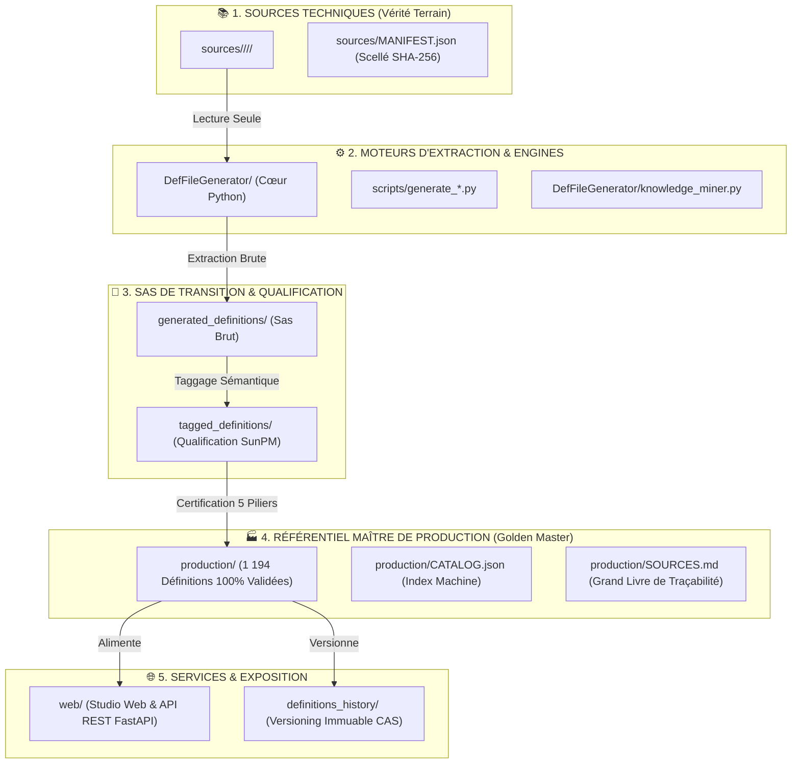

# 🏛️ Architecture Globale & Taxonomie du Projet DefFileGenerator

Ce document présente l'architecture système, l'organisation fonctionnelle des répertoires et les flux de données du projet **WebdynSunPM DefFileGenerator**.

---

## 🎯 Vue d'Ensemble & Vision Système

Le projet a pour mission de convertir des documentations techniques hétérogènes constructeurs (PDF, Excel, XML, HTML) en **fichiers de définition CSV certifiés** et prêts à l'emploi pour les passerelles de télé-relève industrielles **WebdynSunPM**.

Pour garantir une maintenabilité maximale et éliminer toute ambiguïté, l'architecture est articulée autour de **5 domaines fonctionnels étanches** :

---

## 📂 Taxonomie des 5 Domaines Fonctionnels

### 1. 🏭 Référentiel Maître de Production (`production/`) — Single Source of Truth
- **Rôle :** C'est le **catalogue officiel Webdyn**. Tout fichier présent dans ce répertoire a été rigoureusement audité et certifié conforme aux 5 Piliers Apollo.
- **Contenu :** 1 194 définitions CSV normalisées couvrant 138 préfixes constructeurs et plus de 358 000 registres.
- **Gouvernance :**
  - [`production/CATALOG.json`](../production/CATALOG.json) : Catalogue complet interrogeable par l'API et l'interface Web.
  - [`production/SOURCES.md`](../production/SOURCES.md) : Matrice reliant chaque modèle à son document source officiel et à son protocole (Baudrate, FC, Word order).
  - [`production/README.md`](../production/README.md) : Documentation de synthèse des 5 Piliers.

### 2. 📚 Sources Techniques Officielles (`sources/`) — Terrain & Manuels
- **Rôle :** Archive locale standardisée de tous les manuels constructeurs, tables Modbus Excel, profils SunSpec et exports de pages de paramètres HTML.
- **Arborescence :** `sources/<Fabricant>/<Catégorie>/<Gamme>/<Document>` (ex: `sources/CarloGavazzi/Meter/EM530_EM540/`, `sources/Huawei/Inverter/SUN2000_LC/`).
- **Gouvernance :**
  - **Lecture Seule Stricte** sur le partage réseau `\\WDN-FILES.WEBDYN.COM\Support\Equipementiers`.
  - [`sources/MANIFEST.json`](../sources/MANIFEST.json) : Registre cryptographique calculant taille et empreinte SHA-256 de chaque document.

### 3. ⚙️ Cœur Logiciel & Moteurs (`DefFileGenerator/`, `scripts/`)
- **`DefFileGenerator/`** : Librairie Python modulaire :
  - `extractor.py` : Analyseur universel de documents (PDF, Excel, CSV, XML).
  - `def_gen.py` : Moteur de normalisation, conversion d'adresses hex/dec et formatage CSV 11 colonnes.
  - `knowledge_miner.py` : Moteur d'inférence sémantique entraîné pour attribuer les tags SunPM normalisés.
  - `production_governor.py` : Règle de vérification des 5 Piliers Apollo.
  - `tests/` : Suite complète de tests unitaires, fuzzing, red-team et intégration (4 653 tests).
- **`scripts/`** : Scripts CLI opérationnels (build, validation, extraction, journalisation d'audit).

### 4. 🔄 Sas de Transition, Miroirs & Bundles Dédiés
- **`generated_definitions/`** : Sas de transit des extractions brutes issues des parsers avant déduplication.
- **`tagged_definitions/`** : Sas de qualification intermédiaire recevant les enrichissements SunPM.
- **`Definitions/`** : Miroir historique (701 fichiers) conservé pour la rétrocompatibilité des déploiements terrain.
- **`definitions_history/`** : Magasin d'objets immuables (Content-Addressable Storage / CAS) servant au versioning de l'API web.
- **`*_Definitions/`** (`Dyness_DH_Series_Definitions`, `FoxESS_P3_H3_Pro_Definitions`, `MarsRenewable_Definitions`, `X7_Definitions`) : Bundles de livraison dédiés aux constructeurs partenaires.

### 5. 🌐 Interface Web, API & Documentation (`web/`, `docs/`, `logs/`)
- **`web/`** : Application moderne FastAPI avec interface Web interactive (Studio de conversion, exploration de catalogue, visualiseur de diffs et monitoring de santé).
- **`docs/`** : Guides d'ingénierie, dictionnaires de tags SunPM, rapports d'audit et matrices de traçabilité.
- **`logs/`** : Journal d'audit append-only immuable (`audit_log.jsonl`).

---

## 🛡️ Les 5 Piliers Apollo de Certification (Inviolables)

Chaque fichier de définition dans [`production/`](../production/) obéit impérativement aux 5 Piliers Apollo :

| Pilier | Spécification Technique | Règle de Validation Automatisée |
|---|---|---|
| **1. En-tête 11 Colonnes** | Exactement 11 champs séparés par des points-virgules `;` | `len(header) == 11` avec `Modbus;` en première colonne |
| **2. Encodage Strict** | UTF-8 pur sans BOM (Byte Order Mark), fin de ligne CRLF (`\r\n`) | Rejet strict de `\xef\xbb\xbf` et vérification CRLF |
| **3. Indexation Séquentielle** | Indice de variable continu de `1` à `N` sans rupture ni saut | `index == expected_index` sur toute la longueur du fichier |
| **4. Espace d'Adressage Valide** | Adresses Modbus décimales valides entre 0 et 65 535, sans collision | Détection d'intervalles superposés selon la taille du type |
| **5. Unicité des Tags SunPM** | Chaque variable renseignée par un tag SunPM possède un tag unique | Zéro doublon de tag non-vide autorisé au sein d'une définition |

---

## 📋 Matrice Décisionnelle : Où doit aller mon fichier ?

| Si vous avez... | Destination Appropriée | Description |
|---|---|---|
| Un manuel PDF ou tableau Excel constructeur | `sources/<Fabricant>/<Catégorie>/<Gamme>/` | Indexé dans `sources/MANIFEST.json` |
| Une nouvelle définition certifiée et validée | `production/` | Cataloguée dans `production/CATALOG.json` |
| Un script de conversion par lot ou générateur | `scripts/` | Documenté dans `scripts/README.md` |
| Une nouvelle règle d'extraction ou parser | `DefFileGenerator/` | Couvert par des tests dans `DefFileGenerator/tests/` |
| Une documentation de conception ou rapport | `docs/` | Référencé dans l'index de documentation |
| Un log d'audit ou événement d'ingénierie | `logs/audit_trail/` | Format JSONL append-only |
