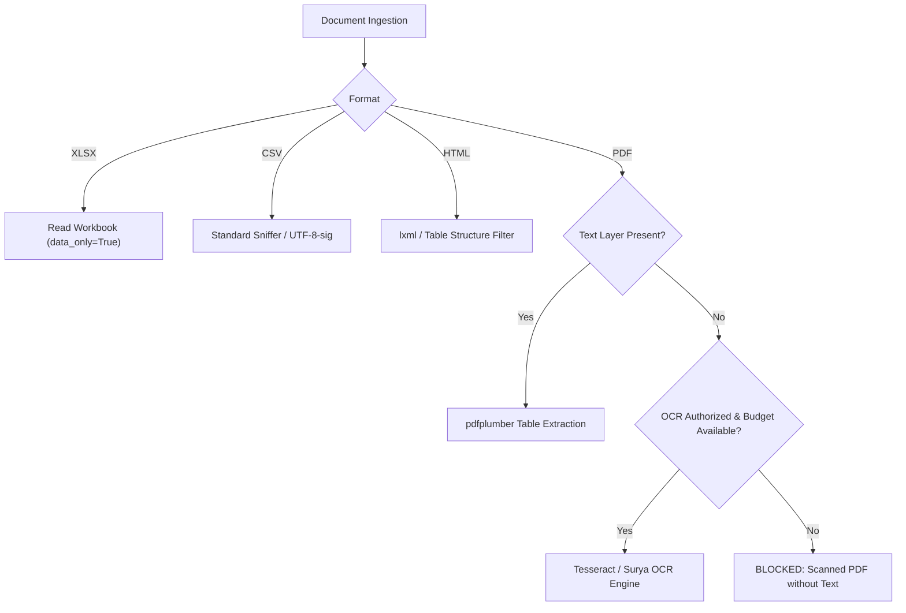

# AUTONOMOUS MODBUS DISCOVERY & DEFINITION GENERATION
## System Architecture & Technical Specification (Phase B)

**Document Version**: 1.0.0-PROPOSED  
**Status**: DESIGN-ONLY (Implementation pending explicit user authorization)  
**Target Systems**: WebdynSunPM (v1 & v2), WebdynSun Classic  
**Core Language**: Python 3.10+ / FastAPI / Pydantic v2  

---

## 1. Executive Summary & Vision

The objective of the **Autonomous Modbus Discovery & Definition Generation** engine is to provide an end-to-end autonomous pipeline that takes an industrial equipment reference (e.g., `Huawei SUN2000-100KTL-M1`, `SMA Sunny Tripower 15000TL`, `Sofar 60KTL-G2`), discovers authoritative Modbus documentation online, retrieves and validates the document securely, extracts the register map across heterogeneous formats (PDF, scanned images, Excel, HTML), normalizes the protocol semantics into a typed canonical intermediate representation, verifies compliance against strict industrial domain invariants, and compiles target-certified definition files (WebdynSunPM CSV) alongside an immutable cryptographic evidence report.

### Non-Negotiable Core Principle
> **Autonomy means automating verified steps without unnecessary manual friction; autonomy NEVER means guessing unverified protocol parameters.**  
> If an address convention, function code, signedness, word endianness, or scale factor cannot be authoritatively established from source evidence, the engine must produce an explicit `REVIEW_REQUIRED` or `AMBIGUOUS_MODEL` status rather than fabricating a plausible but erroneous configuration that could corrupt monitoring or damage field equipment.

---

## 2. Component Reusability & Gap Analysis

| Subsystem | Existing Repository Asset | Reusability Assessment | Required Additions / Gaps |
| :--- | :--- | :--- | :--- |
| **Identity Resolution** | `knowledge_miner.infer_equipment_type`, `def_gen._clean_name` | **Partial (30%)** — Handles basic naming sanitization and equipment category. | **Missing**: Dedicated reference tokenizer, alias registry, hardware revision / firmware matcher, and candidate disambiguator. |
| **Source Discovery** | *None* (Manual file input only) | **Zero (0%)** | **Missing**: Search engine / API adapter, manufacturer domain whitelist, authority ranker, and supersession tracker. |
| **Controlled Retrieval** | `web.app._save_upload` | **Low (15%)** — File upload safety middleware exists. | **Missing**: SSRF-safe HTTP client, DNS-rebinding shield, redirect validator, bandwidth/memory rate-limiters. |
| **Document Ingestion** | `extractor.Extractor` (pdfplumber, openpyxl, csv) | **High (75%)** — Solid table extraction for PDF, Excel, CSV. | **Missing**: OCR fallback adapter (Tesseract/Surya), HTML table scraper, and cell coordinate provenance ledger. |
| **Register Normalization**| `def_gen.Generator.process_rows` | **Medium (50%)** — Address parsing, type synonyms, basic CoefA. | **Missing**: Typed intermediate schema (`CanonicalRegisterRecord`), decoupled from target CSV format. |
| **Semantic Validation** | `production_governor.verify_file_pillars`, `report_generator.audit_definition_file` | **High (80%)** — Robust 5-pillar checks, address overlaps, SunPM tag validation. | **Missing**: Pre-export intermediate model validator, SunSpec model chain dynamic resolver. |
| **Target Export** | `def_gen.Generator`, `generate_foxess_definitions.format_row` | **High (85%)** — Deterministic 11-column CSV generator, BOM handling. | **Missing**: Multi-target profile exporter (WebdynSunPM vs Webdyn Classic 64-bit splitting). |
| **Audit & Provenance** | `logs/audit_trail/audit_log.jsonl` | **High (85%)** — Immutable JSONL logger and report generator. | **Missing**: Property-level evidence citations (page, bounding box, table index, cell coordinate). |

---

## 3. High-Level Architecture & Pipeline Flow

```
[ User Query / Equipment Reference ]
                 │
                 ▼
     [ 1. IdentityResolver ] ──(Ambiguous)──► [ User Clarification / Variant Selection ]
                 │ (Pin Identity)
                 ▼
     [ 2. SourceDiscovery ] ◄── [ Manufacturer Domain Whitelist & Search API ]
                 │ (Ranked Sources)
                 ▼
     [ 3. DocumentFetcher ] ──(Boundary Guard: SSRF / DNS Pinning / Decompression Bomb)
                 │ (Raw Bytes + SHA256)
                 ▼
     [ 4. DocumentExtractor ] ──(PDF / Scanned OCR / XLSX / HTML)
                 │ (Raw Extracted Rows + Bounding Provenance)
                 ▼
     [ 5. RegisterNormalizer ] ──(0/1-Based Offset, Radix, Data Types, Endianness)
                 │ (Canonical Intermediate Representation)
                 ▼
     [ 6. SemanticValidator ] ──(5 Apollo Pillars, Overlap Logic, Sentinel Check)
                 │
        ┌────────┴────────────────────────┐
        ▼                                 ▼
   [ PASSED ]                     [ REVIEW_REQUIRED ]
        │                                 │
        ▼                                 ▼
[ 7. DefinitionExporter ]        [ Interactive Conflict / Ambiguity View ]
  (WebdynSunPM / Classic)                         │
        │                                         ▼
        ▼                               [ Manual Document Upload Fallback ]
[ 8. Certified Output CSV ]
  + [ Evidence Audit Ledger ]
```

---

## 4. Canonical Intermediate Representation (Data Models)

The canonical representation decouples document extraction from target-specific CSV export formats. It is defined in Python using Pydantic v2 schemas:

```python
from enum import Enum
from typing import Optional, List, Dict, Any
from pydantic import BaseModel, Field


class ProtocolTransport(str, Enum):
    MODBUS_RTU = "modbusRTU"
    MODBUS_TCP = "modbusTCP"
    SUNSPEC_RTU = "sunspecRTU"
    SUNSPEC_TCP = "sunspecTCP"


class RegisterSpace(str, Enum):
    HOLDING_REGISTER = "holding_register"  # FC03 / FC06 / FC16
    INPUT_REGISTER = "input_register"  # FC04
    COIL = "coil"  # FC01 / FC05 / FC15
    DISCRETE_INPUT = "discrete_input"  # FC02


class Endianness(str, Enum):
    BIG_ENDIAN = "BE"  # Standard Modbus (AB / ABCD)
    LITTLE_ENDIAN = "LE"  # Word reversed (BA / CDAB)
    MID_BIG_ENDIAN = "MBE"  # Byte swapped within word
    MID_LITTLE_ENDIAN = "MLE"  # Word swapped, byte preserved


class RegisterDataType(str, Enum):
    U16 = "U16"
    S16 = "S16"
    U32 = "U32"
    S32 = "S32"
    U64 = "U64"
    S64 = "S64"
    FLOAT32 = "FLOAT32"
    FLOAT64 = "FLOAT64"
    STRING = "STRING"
    BITFIELD16 = "BITFIELD16"
    BITFIELD32 = "BITFIELD32"


class ProvenanceRecord(BaseModel):
    document_sha256: str
    document_title: str
    page_number: Optional[int] = None
    table_index: Optional[int] = None
    sheet_name: Optional[str] = None
    cell_range: Optional[str] = None
    raw_text_snippet: str
    extraction_confidence: float = Field(default=1.0, ge=0.0, le=1.0)


class CanonicalRegisterRecord(BaseModel):
    id: str  # Unique internal identifier
    name: str  # Manufacturer variable name
    address: int = Field(ge=0, le=65535)  # Protocol address (0-65535)
    address_base_provenance: str  # "documented_0_based", "inferred_1_based", etc.
    register_space: RegisterSpace
    read_fc: int  # 3, 4, 1, 2
    write_fc: Optional[int] = None  # 6, 16, 5, 15
    data_type: RegisterDataType
    register_count: int = Field(ge=1, le=4)
    endianness: Endianness = Endianness.BIG_ENDIAN
    factor: float = 1.0
    offset: float = 0.0
    unit: str = ""
    canonical_sunpm_tag: Optional[str] = None
    action_code: int = 4  # 1: Alarm, 2: Event, 3: Param, 4: Measurement
    is_writable: bool = False
    is_optional: bool = False
    sentinels: List[int] = []  # e.g., 0xFFFF, 0x8000 for invalid
    bit_allocations: Optional[Dict[str, int]] = None
    provenance: ProvenanceRecord


class CanonicalEquipmentModel(BaseModel):
    manufacturer: str
    model: str
    hardware_revisions: List[str] = []
    supported_firmwares: List[str] = []
    transport: ProtocolTransport
    category: str  # Inverter, Meter, Battery, Sensor, Logger, Other
    registers: List[CanonicalRegisterRecord]
    sunspec_base_address: Optional[int] = None
    total_registers: int
    unresolved_rows: List[Dict[str, Any]] = []
```

---

## 5. Component Contracts & Concrete Interfaces

### 5.1 IdentityResolver
```python
class IdentityCandidate(BaseModel):
    manufacturer: str
    model_family: str
    exact_model: str
    hardware_revision: Optional[str]
    firmware_version: Optional[str]
    confidence_score: float
    is_ambiguous: bool
    distinguishing_factors: List[str]


class IdentityResolver:
    async def resolve(self, query: str) -> List[IdentityCandidate]:
        """Tokenizes user reference, scans known manufacturer taxonomy and aliases,
        and returns ranked candidates. If multiple distinct maps exist, flags is_ambiguous=True."""
        ...
```

### 5.2 SourceDiscovery
```python
class DocumentCandidate(BaseModel):
    source_url: str
    title: str
    publisher: str
    is_official_manufacturer: bool
    relevance_rank: int  # 1 to 6 ranking scale
    firmware_applicability: List[str]
    document_date: Optional[str]
    sha256_preview: Optional[str]


class SourceDiscovery:
    async def discover(self, identity: IdentityCandidate) -> List[DocumentCandidate]:
        """Searches manufacturer documentation portals, official CDNs, and indexed repositories.
        Enforces domain whitelisting and ranks sources by authority and exact model coverage."""
        ...
```

### 5.3 DocumentFetcher (Security Guarded)
```python
class FetchOutcome(str, Enum):
    SUCCESS = "success"
    BLOCKED_SSRF = "blocked_ssrf"
    RATE_LIMITED = "rate_limited"
    OVERSPEC_BYTES = "overspec_bytes"
    ACCESS_RESTRICTED = "access_restricted"
    NETWORK_TIMEOUT = "network_timeout"


class FetchResult(BaseModel):
    outcome: FetchOutcome
    file_bytes: Optional[bytes]
    sha256: str
    content_type: str
    final_url: str
    error_message: Optional[str] = None


class DocumentFetcher:
    async def fetch(
        self, candidate: DocumentCandidate, budget_timeout_sec: float = 30.0
    ) -> FetchResult:
        """Retrieves document over HTTPS. Enforces SSRF boundary guards, validates DNS resolution
        against RFC 1918 / loopback / link-local addresses, verifies TLS certs, and caps stream at 25 MB."""
        ...
```

### 5.4 DocumentExtractor
```python
class RawExtractedTable(BaseModel):
    source_page: int
    table_index: int
    headers: List[str]
    rows: List[List[str]]
    confidence: float
    is_ocr: bool


class DocumentExtractor:
    async def extract_tables(self, file_bytes: bytes, file_format: str) -> List[RawExtractedTable]:
        """Detects format (PDF, XLSX, CSV, HTML). Prioritizes native vector/text layers.
        Falls back to bounded OCR only if text density is below threshold (<10 chars/page)."""
        ...
```

### 5.5 RegisterNormalizer
```python
class RegisterNormalizer:
    def normalize(
        self, tables: List[RawExtractedTable], identity: IdentityCandidate
    ) -> CanonicalEquipmentModel:
        """Converts raw table rows into CanonicalRegisterRecord instances.
        Determines 0-based vs 1-based offset from explicit text or register 40001 conventions.
        Normalizes hex vs decimal radix, data types, and factor/unit pairs."""
        ...
```

### 5.6 SemanticValidator (5 Apollo Pillars)
```python
class ValidationStatus(str, Enum):
    VALIDATED_OFFLINE = "VALIDATED_OFFLINE"
    REVIEW_REQUIRED = "REVIEW_REQUIRED"
    AMBIGUOUS_MODEL = "AMBIGUOUS_MODEL"
    SOURCE_CONFLICT = "SOURCE_CONFLICT"
    FAILED_VALIDATION = "FAILED_VALIDATION"


class ValidationOutcome(BaseModel):
    status: ValidationStatus
    pillar_statuses: Dict[str, bool]
    blocking_issues: List[str]
    warnings: List[str]
    reconciliation: Dict[str, int]  # total_extracted, direct_included, excluded_reserved


class SemanticValidator:
    def validate(self, model: CanonicalEquipmentModel) -> ValidationOutcome:
        """Validates canonical model against 5 Apollo Pillars, checks address gaps, detects illegal overlaps,
        and enforces deterministic duplicate name policies."""
        ...
```

### 5.7 DefinitionExporter
```python
class ExportTarget(str, Enum):
    WEBDYN_SUNPM = "webdyn_sunpm"
    WEBDYN_CLASSIC = "webdyn_classic"


class DefinitionExporter:
    def export(
        self, model: CanonicalEquipmentModel, target: ExportTarget = ExportTarget.WEBDYN_SUNPM
    ) -> str:
        """Compiles validated canonical model into standard 11-column semicolon-delimited CSV,
        formatted in UTF-8 without BOM (or with BOM if classic target requires), with 1-based indexing."""
        ...
```

---

## 6. Retrieval Safety & Security Invariants

Direct network retrieval from public endpoints presents attack vectors that must be unconditionally mitigated:

1. **SSRF Boundary Guard**:
   - Resolve target host to IPv4/IPv6 addresses **before** issuing HTTP request.
   - Explicitly reject loopback addresses (`127.0.0.0/8`, `::1`), link-local (`169.254.0.0/16`, `fe80::/10`), private networks (`10.0.0.0/8`, `172.16.0.0/12`, `192.168.0.0/16`), and Cloud metadata endpoints (`169.254.169.254`).
   - Pin DNS resolution: connect directly to the validated IP while passing the original SNI / Host header to prevent DNS-rebinding attacks.
2. **Execution & Parsing Sandbox**:
   - Zero execution privilege: downloaded documents must never be evaluated, executed, or passed to shell processes.
   - For spreadsheets (XLSX): disable macros, VBA execution, and external data connections via `openpyxl(data_only=True)`.
   - Prevent XML External Entity (XXE) and billion-laughs attacks using `defusedxml`.
3. **Resource Bounds**:
   - Max download size: 25 MB. Stream aborts if `Content-Length` or received bytes exceed threshold.
   - Max decompression ratio: 10:1 (protects against gzip/deflate zip-bombs).
   - Monotonic clock timeout: 30 seconds hard abort per retrieval.
   - Max concurrency: 3 simultaneous external downloads across the entire server.

---

## 7. Supported Document Ingestion & OCR Disambiguation



### Critical OCR Disambiguation Matrix
When processing scanned text, the normalizer must apply heuristic and context-aware validation to detect common character substitutions:

| Scanned String | Potential Confusion | Domain Resolution Rule |
| :--- | :--- | :--- |
| `0` vs `O` / `o` | Address `4OO1` | In register address column, replace `O`/`o` with `0` if remainder is numeric. |
| `1` vs `l` / `I` | Address `l001` | In register address column, replace `l`/`I` with `1`. |
| `-` (Minus) | Dropped sign `-10` | Check unit (`°C`, `kVAR`); if range indicates signed values, flag missing sign check. |
| `0x` vs Decimal | `0x1000` (4096) | If prefix `0x` or `H` exists, enforce hex radix; do not treat `1000` hex as `1000` dec. |
| Merged Columns | `40001 Active Power` | Use regex delimiter extraction (`^(\d{4,5})\s+([A-Za-z].*)$`). |

---

## 8. Modbus Semantic Normalization Rules

1. **Address Radix & Base Normalization**:
   - *3xxxx / 4xxxx Reference Notation*: If documented addresses start with `30001` or `40001`, determine whether the author uses standard PLC 1-based notation. Subtract offset (`-30001` or `-40001`) only when proven by contiguous register map semantics or explicit instruction.
   - *Zero-Based vs One-Based*: If the manual defines `Address 0 = Serial Number`, convention is 0-based. If manual defines `Address 1 = Serial Number` and packet capture shows `0x0000`, record `address_base_provenance="offset_1_based"` and adjust for Webdyn target.
2. **Endianness & Word Ordering**:
   - Default Modbus endianness is Big-Endian (`BE`).
   - For 32-bit registers (2 words), distinguish:
     - `High Word First (Big-Endian)`: Word 0 = MSW, Word 1 = LSW.
     - `Low Word First (Little-Endian Word)`: Word 0 = LSW, Word 1 = MSW (common in solar inverters).
   - Never reverse endianness globally without explicit table evidence or equipment profile reference.
3. **Scale Factor & Unit Normalization**:
   - Fractional scaling `0.1` -> `CoefA = 0.100000`, `CoefB = 0.000000`.
   - Scaling `100` (`1/100`th) -> `CoefA = 0.010000`.
   - Gain factor in SunSpec: resolve dynamic SunSpec scale factor reference (e.g., `A_SF`) to the preceding scale-factor register.

---

## 9. Verification & Acceptance Policy

### Discrete Workflow Outcomes
1. `VALIDATED_OFFLINE`: All 5 Apollo Pillars pass, all critical register addresses and types are unambiguously resolved, and target definition is compiled.
2. `REVIEW_REQUIRED`: Document extracted, but one or more non-critical ambiguities (e.g., undefined unit or unmapped alarm bitfield) require user confirmation.
3. `AMBIGUOUS_MODEL`: Multiple incompatible register maps exist for the reference (e.g., hardware V1 vs V2), requiring user variant selection.
4. `SOURCE_CONFLICT`: Multiple authoritative manufacturer documents contradict each other on register addresses.
5. `NOT_FOUND`: Search budget exhausted without locating an authoritative Modbus manual.
6. `BLOCKED_ACCESS`: Source document identified behind paywall, CAPTCHA, or blocked network origin.
7. `FAILED_VALIDATION`: Extracted register table violates physical Modbus constraints (e.g., register address > 65535 or conflicting overlapping word types).

---

## 10. Implementation-Ready Test Matrix (Executable Plan)

When Phase B implementation is authorized, verification must satisfy the following test matrix:

```python
# Test Matrix Specification (docs/AUTONOMOUS_MODBUS_DISCOVERY_SPECIFICATION.md)
TEST_SUITE_PHASE_B = [
    # 1. Identity Resolution Cases
    {
        "id": "TC_ID_01",
        "query": "Huawei SUN2000-100KTL-M1",
        "expected": "SUN2000-100KTL-M1",
        "status": "EXACT",
    },
    {
        "id": "TC_ID_02",
        "query": "Sofar Solar 60KTL",
        "expected": ["60KTL", "60KTL-G2"],
        "status": "AMBIGUOUS_MODEL",
    },
    {"id": "TC_ID_03", "query": "Solplanet Ai-Logger", "expected": "Ai-Logger", "category": "COM"},
    # 2. Retrieval Security (Boundary Guard)
    {
        "id": "TC_SEC_01",
        "url": "http://169.254.169.254/latest/meta-data/",
        "expected": "BLOCKED_SSRF",
    },
    {"id": "TC_SEC_02", "url": "http://127.0.0.1:8000/internal", "expected": "BLOCKED_SSRF"},
    {
        "id": "TC_SEC_03",
        "url": "https://httpbin.org/redirect-to?url=http://192.168.1.1",
        "expected": "BLOCKED_SSRF",
    },
    {"id": "TC_SEC_04", "url": "https://example.com/bomb.zip", "expected": "OVERSPEC_BYTES"},
    # 3. Document Extraction & OCR
    {
        "id": "TC_EXT_01",
        "fixture": "tests/fixtures/huawei_modbus_native.pdf",
        "expected_regs": 105,
        "is_ocr": False,
    },
    {
        "id": "TC_EXT_02",
        "fixture": "tests/fixtures/scanned_abb_meter.pdf",
        "expected_regs": 45,
        "is_ocr": True,
    },
    {
        "id": "TC_EXT_03",
        "fixture": "tests/fixtures/mars_io_multisheet.xlsx",
        "expected_regs": 120,
        "is_ocr": False,
    },
    # 4. Modbus Normalization & Radix
    {"id": "TC_MOD_01", "input_addr": "0x1000", "expected_addr": 4096, "space": "holding_register"},
    {"id": "TC_MOD_02", "input_addr": "40001", "notation": "PLC_1_based", "expected_addr": 0},
    {"id": "TC_MOD_03", "input_scale": "0.01", "expected_coef_a": 0.01, "expected_coef_b": 0.0},
    # 5. Semantic Validation & Export
    {"id": "TC_VAL_01", "fixture": "valid_canonical_inverter", "expected": "VALIDATED_OFFLINE"},
    {
        "id": "TC_VAL_02",
        "fixture": "overlapping_incompatible_types",
        "expected": "FAILED_VALIDATION",
    },
    {
        "id": "TC_EXP_01",
        "fixture": "valid_canonical_inverter",
        "target": "WebdynSunPM",
        "columns": 11,
        "bom": False,
    },
]
```

---

## 11. Dependency-Ordered Implementation Milestones

Should the user authorize implementation, the work must be partitioned and executed across 5 strict milestones:

```
[ Milestone B.1: Security & Identity Subsystem ]
  - Pydantic models (CanonicalRegisterRecord, CanonicalEquipmentModel)
  - SSRF-safe DocumentFetcher with IP pinning and boundary guards
  - IdentityResolver reference tokenizer and alias dictionary
        │
        ▼
[ Milestone B.2: Multi-Format Extraction Engine ]
  - Plumber-based PDF parser hardening with bounding coordinates
  - Native Excel / CSV / HTML extraction adapters
  - Bounded OCR integration (Tesseract fallback with character disambiguation)
        │
        ▼
[ Milestone B.3: Modbus Normalization & Domain Logic ]
  - Radix parser (hex / dec), 0-based vs 1-based offset resolver
  - Scale factor, endianness, signed limits, and word-order converter
  - Dynamic SunSpec model chain traverser
        │
        ▼
[ Milestone B.4: Semantic Validator & Target Exporters ]
  - Pre-export 5 Apollo Pillars validation engine
  - Target exporters (WebdynSunPM v1/v2, Webdyn Classic 64-bit splitting)
  - Cryptographic evidence report builder (SHA-256 + cell citations)
        │
        ▼
[ Milestone B.5: Online Discovery & UI Integration ]
  - Autonomous search orchestrator with manufacturer whitelisting
  - Web UI integration: Reference input, discovery progress, ambiguity resolver
  - End-to-end integration test suite & regression validation
```

---

## 12. Open Technical Decisions Requiring Product Direction

1. **Search API Provider**: Should online discovery utilize a commercial search API (e.g., Google Custom Search API, Bing Web Search API, Serper) requiring an API key, or rely strictly on direct scraping of curated manufacturer portal directories?
2. **OCR Engine Deployment**: For scanned PDFs, should the engine depend on a local system installation of Tesseract OCR (`pytesseract`), a pure Python neural model (`surya-ocr`), or require user-uploaded digital vector PDFs?
3. **Tag Attribution Policy**: In fully autonomous mode, should new definition files strictly leave tags blank unless 100% matched to official `SunPM_DEfFile_Tags_v1.xlsx` canonical entries? *(Recommended: YES, leave blank to preserve Apollo Invariant 4)*.

---
*End of Technical Specification — Phase B (Autonomous Modbus Discovery).*
