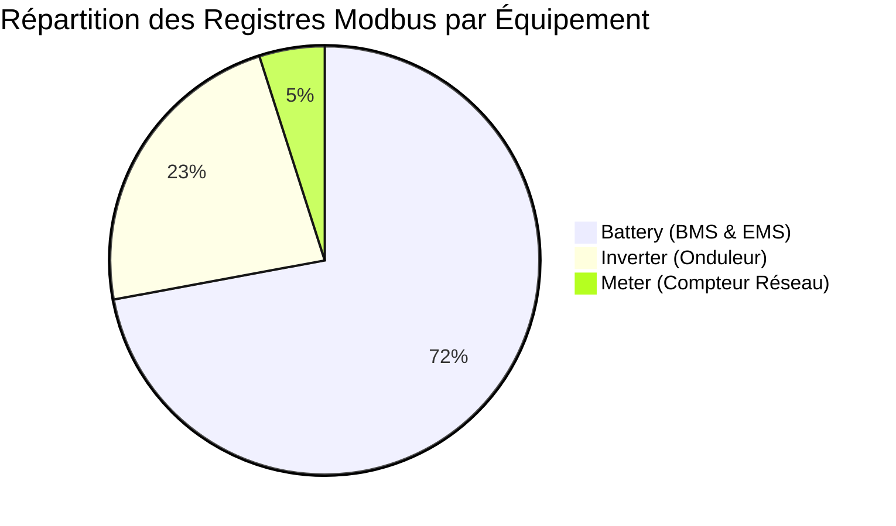

# 📊 RAPPORT TECHNIQUE DE GÉNÉRATION — FOX ESS GAMMES P3 & H3 PRO
## Inverter, Meter & Battery — Conformité WebdynSunPM & Cartographie des Tags SunPM
**Constructeur** : `Fox ESS` · **Modèles** : `P3 Pro / H3 Pro Series`  
**Répertoire source & destination réseau** : `\\WDN-FILES.WEBDYN.COM\Support\Equipementiers\Fox ESS`  
**Statut Global** : **100.0% VALIDE (Schéma Webdyn 11 Colonnes)**

---

## 1. Synthèse des 3 Fichiers de Définition Régénérés

| Composant | Fichier Définition Webdyn | Total Registres | Tags SunPM | % Balisage | FC Modbus | Consignes (Act=1) | Alarmes (Act=9) | Validité |
| :--- | :--- | :---: | :---: | :---: | :---: | :---: | :---: | :---: |
| **Inverter (Onduleur)** | `FOXESS_P3_H3_PRO_INVERTER.csv` | **285** | **111** | 38.9% | FC03 Holding | **43** | **0** | ✅ **100% Conforme** |
| **Meter (Compteur)** | `FOXESS_P3_H3_PRO_METER.csv` | **61** | **27** | 44.3% | FC03 Holding | **3** | **1** | ✅ **100% Conforme** |
| **Battery (Batterie / BMS)** | `FOXESS_P3_H3_PRO_BATTERY.csv` | **893** | **18** | 2.0% | FC03 Holding | **692** | **6** | ✅ **100% Conforme** |
| **TOTAL COMBINÉ** | **3 Fichiers Définition** | **1239** | **156** | **12.6%** | **FC03 (100%)** | **738** | **7** | ✅ **3 / 3 Valides** |

---

## 2. Cartographie Industrielle des Tags SunPM Assignés

### 2.1 Onduleur (`Inverter`)
- **Identification** : `MODEL` (30000), `SERIAL` (30016), `MANUFACTURER` (30032), `P_RATED` (39053, 0.001 kW)
- **Télémétrie AC Triphasée** :
  - Tensions de réseau : `U_AC_1` (39123), `U_AC_2` (39124), `U_AC_3` (39125)
  - Courants onduleur : `I_AC_1` (39126), `I_AC_2` (39128), `I_AC_3` (39130)
  - Puissances actives : `P_AC` total (39134), `P_AC_1` (39248), `P_AC_2` (39250), `P_AC_3` (39252)
  - Puissances réactives : `Q_AC` total (39136), `Q_AC_1` (39256), `Q_AC_2` (39258), `Q_AC_3` (39260)
  - Puissances apparentes : `S_AC` total (39270), `S_AC_1` (39264), `S_AC_2` (39266), `S_AC_3` (39268)
  - Facteur de puissance & Fréquence : `PF` (39138), `PF_1` (39424), `PF_2` (39425), `PF_3` (39426), `FREQ` (39139)
- **Champs Solaires (DC & MPPT)** :
  - Tensions et courants PV1 à PV24 : `U_DC_MPPT_[1..24]`, `I_DC_MPPT_[1..24]`
  - Puissance DC totale : `P_DC` (39118)
- **Production d'Énergie** : `E_TOT` (39149, kWh), `E_DAY` (39151, kWh)
- **Diagnostic & Environnement** : `TEMP_INT` (39141, °C), `R_ISO` (39068_2_1)
- **Pilotage & Consignes Réseau (`Action = 1`)** :
  - Allumage / Extinction : `CMD_ON` (49077), `CMD_OFF` (49078)
  - Consigne de puissance active absolue : `CMD_P_AC_SET_ABS` (46003, 49008)
  - Consigne de puissance active en pourcentage : `CMD_P_AC_SET_PERCENT` (49007)
  - Limitation d'export / bridage injection : `CMD_P_AC_LIM_ABS` (46616)
  - Consigne réactive : `CMD_Q_AC_SET_ABS` (46005)

### 2.2 Compteur Réseau (`Meter`)
- **Identification** : `SERIAL` (36100), `MANUFACTURER` (36116), `MODEL` (36132)
- **Télémétrie AC Point de Livraison** :
  - Tensions de phases : `U_AC_1` (38802), `U_AC_2` (38804), `U_AC_3` (38806)
  - Courants de phases : `I_AC_1` (38808), `I_AC_2` (38810), `I_AC_3` (38812)
  - Puissance active combinée et par phase : `P_AC` (38814), `P_AC_1` (38816), `P_AC_2` (38818), `P_AC_3` (38820)
  - Puissance réactive combinée et par phase : `Q_AC` (38822), `Q_AC_1` (38824), `Q_AC_2` (38826), `Q_AC_3` (38828)
  - Puissance apparente combinée et par phase : `S_AC` (38830), `S_AC_1` (38832), `S_AC_2` (38834), `S_AC_3` (38836)
  - Facteur de puissance et fréquence : `PF` (38838), `PF_1` (38840), `PF_2` (38842), `PF_3` (38844), `FREQ` (38846)
- **Supervision & Alertes** : Alerte perte de compteur `ALARM` (39069_9_1, `Action = 9`), compensation compteur (49248, `Action = 1`)

### 2.3 Système de Batterie & BMS (`Battery`)
- **Identification** : `MODEL` (30000), `SERIAL` (30016), `MANUFACTURER` (30032)
- **Grandeurs Électriques & Thermiques DC** :
  - Tension du pack DC : `U_DC` (37609)
  - Courant de charge/décharge DC : `I_DC` (37610)
  - Température ambiante BMS : `TEMP` (37611)
  - État de charge : `SOC` (37612, %)
  - État de santé : `SOH` (37624, %)
  - Extrêmes thermiques : `TEMP_MAX` (37617), `TEMP_MIN` (37618)
  - Extrêmes de tension de cellules : `U_CELL_MAX` (37619, mV), `U_CELL_MIN` (37620, mV)
- **Sécurité & Défauts (`Action = 9`)** : Défauts BMS 1 à 6 (`ALARM_1` à `ALARM_6`, 37626 à 37631)
- **Gestion EMS & Plages Horaires (`Action = 1`)** :
  - 96 Groupes de plages horaires de charge/décharge (registres 48000 à 48966)
  - Préchauffage batterie BMS Warm-Up (registres 53400 à 53411)

---

## 3. Emplacements des Fichiers Déployés

1. **Partage Réseau Constructeurs** :
   - `\\WDN-FILES.WEBDYN.COM\Support\Equipementiers\Fox ESS\FOXESS_P3_H3_PRO_INVERTER.csv`
   - `\\WDN-FILES.WEBDYN.COM\Support\Equipementiers\Fox ESS\FOXESS_P3_H3_PRO_METER.csv`
   - `\\WDN-FILES.WEBDYN.COM\Support\Equipementiers\Fox ESS\FOXESS_P3_H3_PRO_BATTERY.csv`
   - `\\WDN-FILES.WEBDYN.COM\Support\Equipementiers\Fox ESS\FoxESS_P3_H3_PRO.csv`
2. **Bibliothèques Locales de Définitions Générées & Balisées** : `generated_definitions/` et `tagged_definitions/`
