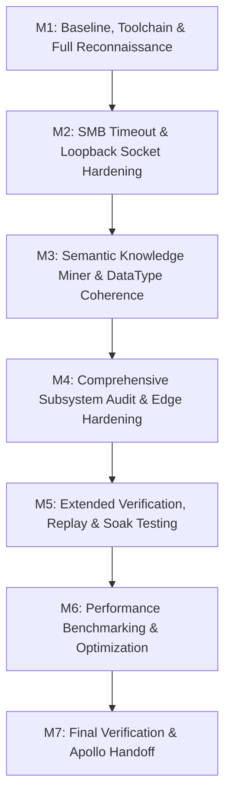

# Apollo-Standard Engineering Plan: DefFileGenerator

## 1. Project Profile and Mission Scope

- **Repository**: DefFileGenerator (https://github.com/Cylae/DefFileGenerator.git)
- **Local Path**: `C:\Users\Cylae\Documents\GitHub\DefFileGenerator`
- **Initial Commit Snapshot**: `b100a84` (fast-forwarded cleanly to origin/main `3d68fd8`)
- **Language / Runtime**: Python 3.10-3.14 (Active runtime: Python 3.14.7 x86_64 on Windows 11)
- **Package Management**: `uv` 0.12.9 with `pyproject.toml` and `uv.lock`
- **Application Type**: Multi-interface system:
  1. CLI (`DefFileGenerator/main.py`)
  2. Desktop GUI (`DefFileGenerator/gui.py` via `customtkinter`)
  3. Web REST API & SPA (`web/app.py`, `web/static/` via FastAPI/Starlette)
  4. Core Extractor & Engine (`DefFileGenerator/extractor.py`, `DefFileGenerator/def_gen.py`)
  5. Semantic Knowledge Miner (`DefFileGenerator/knowledge_miner.py`)
  6. Generator & Reporting modules (`DefFileGenerator/mars_generator.py`, `DefFileGenerator/report_generator.py`)
- **Product Contract**: Accurate extraction of Modbus register maps from heterogeneous technical documents (PDF, Excel, CSV, XML) and generation of syntactically and semantically validated WebdynSunPM definition CSV files compliant with official Webdyn gateway specifications.

---

## 2. Milestones and Dependencies

### Milestone 1: Baseline, Toolchain & Full Reconnaissance [IN PROGRESS]
- **Objective**: Establish toolchain facts, execute baseline verification, catalog all first-party files and assets.
- **Acceptance Criteria**:
  - Full inventory of all source, test, configuration, and documentation files.
  - Baseline execution of linting (`ruff`), typing (`mypy`), security (`bandit`), and unit test suite.
  - Discovery of all initial issues and blockers.

### Milestone 2: Environmental Hardening (SMB Timeouts & Loopback Socket) [PLANNED]
- **Objective**: Eliminate blocking delays and timeouts in tests and runtime.
  - Root cause 1: `DEFAULT_EQUIPEMENTIERS_DIR = r"\\WDN-FILES.WEBDYN.COM\Support\Equipementiers"` incurs a 30-45s Windows SMB network timeout when not connected to the corporate VPN/LAN.
  - Root cause 2: Asyncio `_fallback_socketpair` under Windows sandbox when loopback network is disabled.
- **Acceptance Criteria**:
  - Fast-failing network path detection or timeout-guarded probes.
  - Smooth execution in offline and sandboxed environments.

### Milestone 3: Semantic Knowledge Miner & Type System Consistency [PLANNED]
- **Objective**: Verify register types, SunSpec normalization, and tag mining accuracy across all 250+ supported devices.
- **Acceptance Criteria**:
  - Type normalization correctly handles `bool`/`boolean` -> `BITS`, SunSpec types (`sunssf` -> `I16`, `acc32` -> `U32`, etc.).
  - Overlap detection, address boundaries, and multi-sheet coordinate mappings remain strictly validated.

### Milestone 4: Subsystem Audit & Hardening [PLANNED]
- **Objective**: Review all core files (`def_gen.py`, `extractor.py`, `gui.py`, `web/app.py`, `knowledge_miner.py`, `main.py`).
- **Acceptance Criteria**:
  - Every error path handled explicitly.
  - No resource leaks, unclosed file descriptors, or unsafe fallbacks.
  - Atomic writing and CSV formula injection defenses intact across all paths.

### Milestone 5: Extended Verification & Adversarial Testing [PLANNED]
- **Objective**: Run full test battery (1,040+ tests), stress tests, and adversarial security tests.
- **Acceptance Criteria**:
  - 100% test pass rate.
  - Zero bandit security issues.
  - Zero mypy type issues across all packages.
  - Clean ruff lint and format checks.

### Milestone 6: Performance Profiling & Optimization [PLANNED]
- **Objective**: Profile extraction hot paths (PDF text extraction, multi-sheet Excel scanning, overlap checking).
- **Acceptance Criteria**:
  - Measured execution times for benchmark datasets.
  - Documented memory profiles.

### Milestone 7: Final Documentation, Verification & Handoff [PLANNED]
- **Objective**: Deliver verified Apollo-standard documentation and complete handoff package in French.

