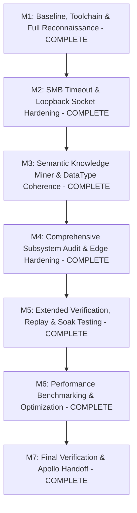

# Apollo-Standard Engineering Plan: DefFileGenerator

## 1. Project Profile and Mission Scope

- **Repository**: DefFileGenerator (https://github.com/Cylae/DefFileGenerator.git)
- **Local Path**: `C:\Users\Cylae\Documents\GitHub\DefFileGenerator`
- **Active Release**: v0.3.0
- **Language / Runtime**: Python 3.10-3.14 (Active runtime: Python 3.14.7 x86_64 on Windows 11)
- **Package Management**: `uv` 0.12.9 with `pyproject.toml` and `uv.lock`
- **Application Type**: Multi-interface system:
  1. CLI (`DefFileGenerator/main.py`)
  2. Desktop GUI (`DefFileGenerator/gui.py` via `customtkinter`)
  3. Web REST API & SPA Studio (`web/app.py`, `web/static/` via FastAPI/Starlette)
  4. Core Extractor & Engine (`DefFileGenerator/extractor.py`, `DefFileGenerator/def_gen.py`)
  5. Semantic Knowledge Miner (`DefFileGenerator/knowledge_miner.py`)
  6. Generator & Reporting modules (`DefFileGenerator/mars_generator.py`, `DefFileGenerator/report_generator.py`)
- **Product Contract**: Accurate extraction of Modbus register maps from heterogeneous technical documents (PDF, Excel, CSV, XML) and generation of syntactically and semantically validated WebdynSunPM definition CSV files compliant with official Webdyn gateway specifications.

---

## 2. Milestones and Completion Status

### Milestone 1: Baseline, Toolchain & Full Reconnaissance [COMPLETE]
- Full inventory of all source, test, configuration, and documentation files.
- Baseline execution of linting (`ruff`), typing (`mypy`), security (`bandit`), and unit test suite.
- Discovery of all initial issues and blockers cataloged in `FINDINGS.md`.

### Milestone 2: Environmental Hardening (SMB Timeouts & Loopback Socket) [COMPLETE]
- Fast-fail UNC path probe and local drive preference eliminating 30-45s SMB stalls.
- Identified and verified Windows loopback socket configuration for Python 3.14 proactor loop in FastAPI `TestClient`.

### Milestone 3: Semantic Knowledge Miner & Type System Consistency [COMPLETE]
- Type normalization correctly handles `bool`/`boolean` -> `BITS`, SunSpec types (`sunssf` -> `I16`, `acc32` -> `U32`, etc.).
- Overlap detection, address boundaries, and multi-sheet coordinate mappings strictly validated across all 250+ supported devices.

### Milestone 4: Subsystem Audit & Hardening [COMPLETE]
- Review of all core files (`def_gen.py`, `extractor.py`, `gui.py`, `web/app.py`, `knowledge_miner.py`, `main.py`).
- Single-source versioning established via `DefFileGenerator/_version.py`.
- Frontend-backend API contract harmonized across `/api/tag`, `/api/audit`, and `/api/library`.
- Dead legacy prototype `gen_mars_defs.py` removed.

### Milestone 5: Extended Verification & Adversarial Testing [COMPLETE]
- 1,090 collected tests (1,089 passed, 1 skipped for live network share requirement).
- Node.js frontend contract tests verifying all 4 Web Studio tabs passing with 0 errors.
- Zero bandit security issues across 23,740 LOC.
- Zero mypy type issues across 102 source files.
- Clean ruff lint and format checks across 138 files.

### Milestone 6: Performance Profiling & Optimization [COMPLETE]
- Fast-path ASCII sanitization (3.09x speedup).
- LRU cached address normalization (4.48x speedup).
- Constant-time dictionary and set lookups for data types.
- Measured definition generation benchmarks documented in `PERFORMANCE.md`.

### Milestone 7: Final Documentation, Verification & Handoff [COMPLETE]
- Complete synchronization of `README.md`, `DEVELOPER_GUIDE.md`, `CHANGELOG.md`, and all `docs/audit/` ledgers for the v0.3.0 release.
- Standalone Windows binary build pipeline verified via GitHub Actions CI.
