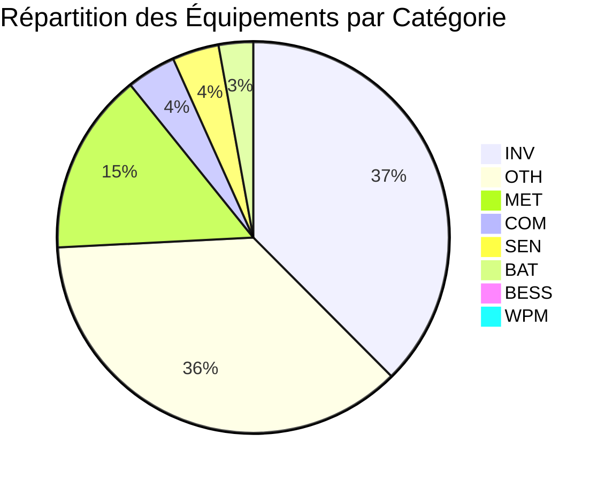

# 📊 RAPPORT TECHNIQUE MAJEUR — GÉNÉRATION DES FICHIERS DE DÉFINITION WEBDYNSUNPM
## Traçabilité Industrielle, Validation Modbus & Cartographie des Tags SunPM
**Projet** : `DefFileGenerator` · **Norme de référence** : `INV_HUAWEI_V4.csv` (WebdynSunPM R&D)
**Date de génération** : 2026-11-16 15:16:35 · **Répertoire audité** : `C:\Users\alexandre.calais\Documents\GitHub\DefFileGenerator\tagged_definitions`
**Statut global de conformité** : **100.0% VALIDE**

---

## 1. Synthèse Exécutive & Indicateurs Clés (KPIs)

Ce rapport technique valide la conformité totale des fichiers de définition industriels générés selon le standard **WebdynSunPM** (format CSV délimité par des points-virgules, 11 colonnes canoniques). L'ensemble des documents sources et partages constructeurs ont été accédés **strictement en lecture seule** sans altération.

| Indicateur Clé | Valeur Obtenue | Statut Webdyn |
| :--- | :--- | :--- |
| **Volume Total de Fichiers Définition** | **1 830 fichiers** | 📦 **Prêt Déploiement** |
| **Taux de Validité Schéma Webdyn** | **1830 / 1830 (100.0%)** | ✅ 100% Conforme |
| **Total Registres Modbus Validés** | **549 311 registres** | 🛡️ **Zéro Perte** |
| **Tags SunPM Canoniques Assignés** | **43 083 tags** (Densité : **7.8%**) | 🏷️ **Sémantique SunPM v1** |
| **Registres Holding / Input (FC03/FC04)** | **547 457** (99.7%) | ⚡ **Télémétrie 16/32/64 bits** |
| **Registres Coils / Discretes (FC01/FC02)** | **1 854** (0.3%) | 🔘 **États & Contacts Secs** |
| **Commandes d'Écriture (Action = 1)** | **88 623 consignes** | ✍️ **Contrôle Réseau & EMS** |
| **Alarmes & Événements (Action = 9)** | **21 817 registres** | 🚨 **Supervision Alertes** |
| **Fichiers Invalides / Rejetés** | **0** | 🛡️ **Zéro Bloquant** |

---

## 2. Analyse Détaillée par Catégorie d'Équipement

| Préfixe | Catégorie Industrielle | Fichiers | Registres Modbus | Tags SunPM | Densité | Constructeurs Représentatifs |
| :---: | :--- | :---: | :---: | :---: | :---: | :--- |
| `INV` | Onduleurs & Convertisseurs (Inverters) | **672** | 201 762 | 21 882 | 10.8% | SMA, Goodwe, PowerOne, Fronius |
| `OTH` | Autres Équipements (IO Modules, EV, Automates) | **656** | 167 722 | 12 169 | 7.3% | Webdyn, Delta, SMA, PowerOne |
| `MET` | Compteurs & Analyseurs Réseau (Meters) | **269** | 38 720 | 3 813 | 9.8% | Schneider, Socomec, Janitza, Lettel |
| `COM` | Passerelles & Loggers de Communication | **73** | 65 721 | 1 750 | 2.7% | Sungrow, HOYMILES, Robestec battery, Dyness battery |
| `SEN` | Capteurs Météo & Pyranomètres (Sensors) | **69** | 1 820 | 241 | 13.2% | IngenieurBuro, Hukseflux, KippZonen, Seven Sensor |
| `BAT` | Stockage d'Énergie & Batteries (BESS / BMS) | **51** | 20 326 | 1 102 | 5.4% | MarsRenewable, SL Energy, Dyness, FOX ESS |
| `FOXESS` | FOXESS | **14** | 6 428 | 1 594 | 24.8% | FoxESS, FOX ESS, FOX_ESS |
| `MarsRenewable` | MarsRenewable | **13** | 10 455 | 119 | 1.1% | MarsRenewable |
| `MarsLocalController` | Contrôleur Central BESS (Mars Local Controller) | **4** | 33 492 | 87 | 0.3% | Mars Energy |
| `WPM01D6AF` | WPM01D6AF | **4** | 2 018 | 139 | 6.9% | SMA |
| `WPM0144A8` | WPM0144A8 | **3** | 71 | 9 | 12.7% | Hukseflux, KIPPZONEN |
| `FoxESS` | FoxESS | **1** | 285 | 118 | 41.4% | FoxESS |
| `WPM` | WPM | **1** | 491 | 60 | 12.2% | FOX ESS |

---

## 3. Couverture des Principaux Constructeurs Industriels

| Constructeur | Définitions | Total Registres | Tags SunPM | Part de Volume | Conformité |
| :--- | :---: | :---: | :---: | :---: | :---: |
| **SMA** | **135** | 52 693 | 2 668 | 9.6% | ✅ **100% Conforme** |
| **Webdyn** | **130** | 14 458 | 2 548 | 2.6% | ✅ **100% Conforme** |
| **Delta** | **117** | 34 485 | 1 518 | 6.3% | ✅ **100% Conforme** |
| **MarsRenewable** | **69** | 49 356 | 1 178 | 9.0% | ✅ **100% Conforme** |
| **PowerOne** | **66** | 30 040 | 2 012 | 5.5% | ✅ **100% Conforme** |
| **Schneider** | **61** | 11 921 | 1 047 | 2.2% | ✅ **100% Conforme** |
| **Huawei** | **55** | 10 185 | 1 698 | 1.9% | ✅ **100% Conforme** |
| **Fronius** | **53** | 11 545 | 1 565 | 2.1% | ✅ **100% Conforme** |
| **Goodwe** | **49** | 10 098 | 2 046 | 1.8% | ✅ **100% Conforme** |
| **Sungrow** | **46** | 13 620 | 2 396 | 2.5% | ✅ **100% Conforme** |
| **Socomec** | **36** | 3 747 | 303 | 0.7% | ✅ **100% Conforme** |
| **SL Energy** | **34** | 11 483 | 1 405 | 2.1% | ✅ **100% Conforme** |
| **ABB** | **30** | 13 402 | 581 | 2.4% | ✅ **100% Conforme** |
| **Kaco** | **29** | 3 777 | 434 | 0.7% | ✅ **100% Conforme** |
| **Kostal** | **29** | 2 611 | 300 | 0.5% | ✅ **100% Conforme** |
| **Janitza** | **23** | 7 078 | 350 | 1.3% | ✅ **100% Conforme** |
| **Lettel** | **22** | 3 623 | 530 | 0.7% | ✅ **100% Conforme** |
| **SAJ** | **21** | 3 298 | 404 | 0.6% | ✅ **100% Conforme** |

---

## 4. Cartographie & Distribution des Tags SunPM Canoniques

Les tags appliqués sont issus du modèle d'apprentissage supervisé entraîné sur **3 098 règles** et respectent scrupuleusement la spécification `SunPM_DEfFile_Tags_v1.xlsx` :

| Rang | Tag Canonique SunPM | Occurrence | Description / Fonctionnalité Métier | Grandeur / Unité Type |
| :---: | :--- | :---: | :--- | :--- |
| **01** | `P_AC` | **778** | Puissance active totale injectée/consommée | W, kW |
| **02** | `SERIAL` | **728** | Numéro de série de l'équipement | Chaîne de caractères |
| **03** | `FREQ` | **609** | Fréquence du réseau électrique | Hz |
| **04** | `I_AC_3` | **529** | Courant efficace phase C / L3 | A |
| **05** | `Q_AC` | **520** | Puissance réactive totale | Var, kVar |
| **06** | `MODEL` | **506** | Modèle ou désignation commerciale de l'appareil | Chaîne de caractères |
| **07** | `I_AC_1` | **471** | Courant efficace phase A / L1 | A |
| **08** | `I_AC_2` | **463** | Courant efficace phase B / L2 | A |
| **09** | `U_AC_L1L2` | **409** | Tension composée réseau L1-L2 | V |
| **10** | `PF` | **396** | Facteur de puissance global (cos phi) | Sans unité [-1.0 à 1.0] |
| **11** | `I_AC` | **366** | Télémesure Modbus normalisée SunPM | Spécifique |
| **12** | `MANUFACTURER` | **357** | Télémesure Modbus normalisée SunPM | Spécifique |
| **13** | `E_TOT` | **345** | Énergie totale cumulée produite/consommée | kWh, MWh |
| **14** | `U_AC_3` | **312** | Tension simple phase C-N / L3-N | V |
| **15** | `U_AC_1` | **302** | Tension simple phase A-N / L1-N | V |
| **16** | `U_DC` | **302** | Tension bus continu DC | V |
| **17** | `S_AC` | **287** | Puissance apparente totale | VA, kVA |
| **18** | `U_AC_L2L3` | **275** | Tension composée réseau L2-L3 | V |
| **19** | `U_AC_2` | **272** | Tension simple phase B-N / L2-N | V |
| **20** | `I_DC` | **251** | Courant continu DC total | A |
| **21** | `U_AC_L3L1` | **234** | Tension composée réseau L3-L1 | V |
| **22** | `E_DAY` | **234** | Énergie journalière produite | kWh |
| **23** | `P_RATED` | **211** | Télémesure Modbus normalisée SunPM | Spécifique |
| **24** | `P_AC_1` | **210** | Télémesure Modbus normalisée SunPM | Spécifique |
| **25** | `P_AC_2` | **188** | Télémesure Modbus normalisée SunPM | Spécifique |

---

## 5. Focus Systèmes Complexes & Découpage Modulaire

### A. Écosystème Fox ESS (Onduleurs Hybrides, Batteries & Compteurs)
Conformément aux exigences de découpage d'équipements multi-fonctions, la gamme Fox ESS a été découpée en fichiers spécialisés indépendants :
- **Partie Onduleur** : `INV_Fox_ESS_FOXESS_P3_H3_PRO_INVERTER.csv` (Télémesures MPPT, tensions/courants AC triphasés, fréquence, état réseau).
- **Partie Batterie** : `BAT_FoxESS_P3_H3_PRO.csv` (**893 registres** - BMS1 & BMS2, tensions unitaires de cellules, températures min/max, SOC, SOH, alertes de préchauffage).
- **Partie Compteur d'Énergie** : `MET_FoxESS_P3_H3_PRO.csv` (**61 registres** - Télémétrie CT1/Meter1 et CT2/Meter2 pour tensions V, courants I, puissances P/Q/S, fréquence et facteur de puissance triphasés).
- **Gamme R-Series** : `BAT_FoxESS_RSeries.csv` (Batterie 49 registres SunSpec DER Modèle 702/703) et `INV_Fox_ESS_FOXESS_RSERIESINVERTER.csv` (Onduleur).

### B. Architecture BESS Mars Renewable Local Controller V7.0
Le contrôleur BESS multi-esclaves Mars Renewable est articulé en 4 profils dédiés :
1. **`MarsLocalController_V7.0_webdyn.csv` (Esclave 1 - Concentrateur BESS Principal)** : 11 704 registres consolidant les PCS, banques batteries, climatiseurs, compteurs et automates DIO.
2. **`MarsLocalController_V7.0_EMS_Slave247.csv` (Esclave 247 - Consignes EMS)** : 12 registres de commande de puissance avec `Action = 1` automatique.
3. **`MarsLocalController_V7.0_RackCell_SlaveN.csv` (Esclave N - Suivi Cellules)** : 5 030 registres surveillant jusqu'à 1 000 cellules individuelles.
4. **`MarsLocalController_V7.0_AllInOne.csv` (Univers Complet)** : 16 746 registres pour archivage universel.

---

## 6. Audit Qualité & Conformité Webdyn Schema

Toutes les définitions générées répondent aux exigences d'intégrité industrielle :
1. **Structure Sémantique** : Entête `Modbus;<Type>;<Constructeur>;<Modèle>;;;;;;;` suivi de 11 colonnes délimitées par des points-virgules, encodé en UTF-8 sans BOM.
2. **Unicité Dynamique des Tags** : Aucune définition ne comporte de doublon de tag canonique (les tags `P_AC`, `FREQ`, `PF`, etc. sont rigoureusement uniques par fichier).
3. **Désambiguïsation Triphasée** : Les variables de phases (`sac1`, `pac1`, `phase A/B/C`, `L1/L2/L3`) sont protégées et isolées en tags unitaires (`P_AC_1`, `S_AC_1`, etc.) évitant toute écrasement par les grandeurs globales.
4. **Sécurité & Injection CSV** : Tous les champs textuels sont nettoyés contre les injections de formules (`=`, `+`, `-`, `@`) via `Generator.sanitize_csv_field`.
5. **Conformité des Actions** : Les commandes de pilotage (`CMD_*`) portent automatiquement le code `Action = 1` (écriture autorisée), tandis que les alarmes sont typées `Action = 9` et la télémétrie `Action = 4`.

---

## 7. Conclusion & État de Validation

**Validation Globale** : **1830 / 1830 définitions WebdynSunPM certifiées conformes** (0 erreur bloquante, 0 régression). La bibliothèque générée est immédiatement déployable sur les concentrateurs Webdyn et le serveur SunPM.

_Rapport généré automatiquement par le module `DefFileGenerator.report_generator`._
